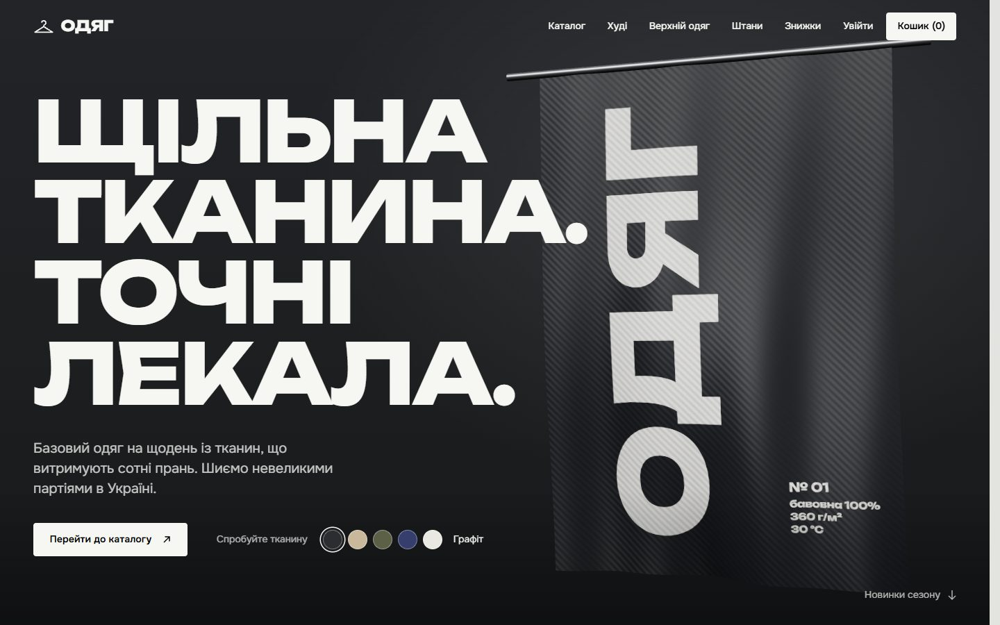
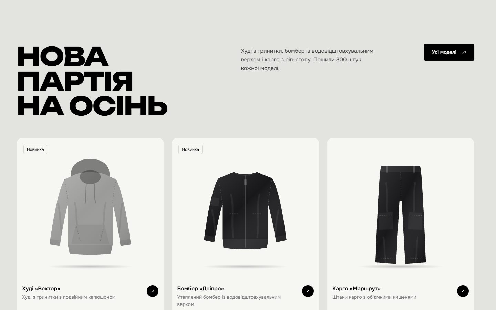
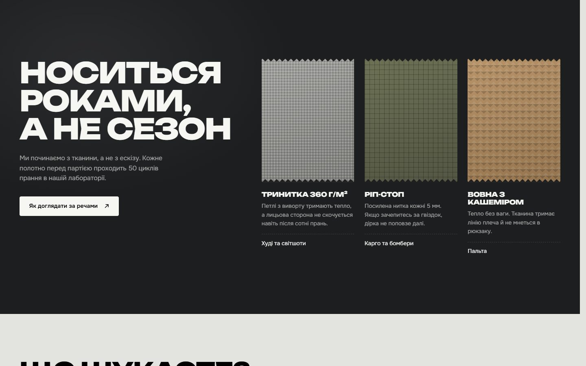
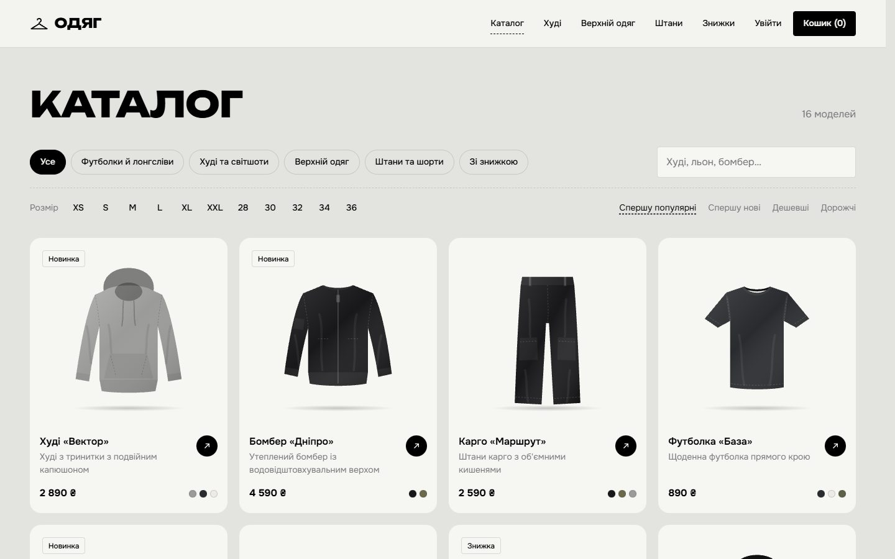
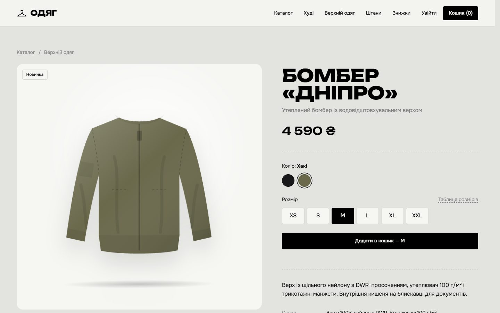
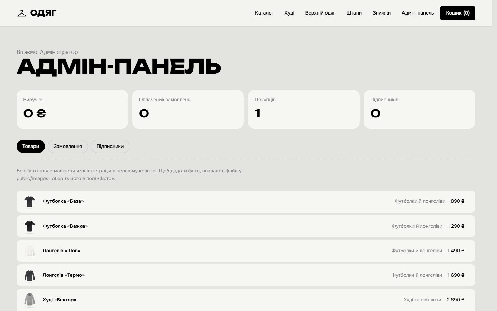
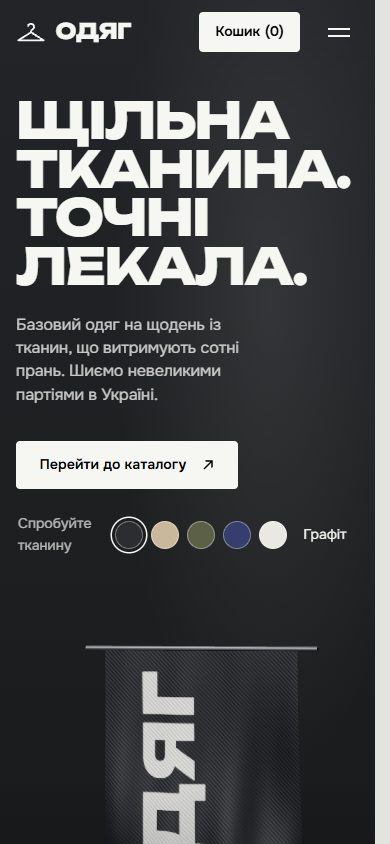
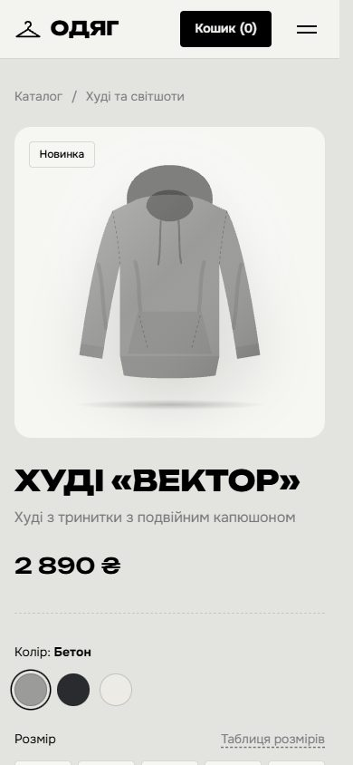

# Одяг — clothing store

Одяг (Ukrainian for "clothing") is a full-stack online store for everyday basics, built as a demo project. Visitors browse a filterable catalog, pick a colour and size, fill a cart and check out with Nova Poshta delivery details. Payment goes through Stripe, or runs in demo mode when no key is set. Customers follow their orders in a personal account. The owner manages products, order statuses and newsletter subscribers in an admin panel.

The landing page opens with a real-time 3D scene: a length of printed cotton hangs from a steel rod, moves in the wind and dents where the cursor presses it. Visitors can recolour the fabric with the swatches under the headline. Products without a photo are drawn as SVG flat-lay illustrations in whichever colour the shopper selects.

The storefront is in Ukrainian; prices are in hryvnias (UAH).

**Stack:** Next.js 16 (App Router, Server Actions), React 19, TypeScript, PostgreSQL with Prisma 7, Three.js with custom GLSL shaders, GSAP, Lenis, Zod, Stripe.

## Screenshots



| | |
| --- | --- |
|  |  |
|  |  |

Admin panel:



Mobile:

<p>
  
  
</p>

## Features

- **Catalog**: filters by category, size and discount, plus text search and four sort orders. The filters live in the URL, so every filtered view can be shared or bookmarked.
- **Product page**: colour and size selection. The illustration recolours instantly and tilts toward the pointer. A "from the same shelf" block shows related items.
- **Cart and checkout**: quantity controls, a free-delivery threshold, and a delivery form with Ukrainian phone validation. Order lines keep a copy of the name, size, colour and price, so later product edits never rewrite order history.
- **Payments**: Stripe Checkout in UAH, confirmed by a signed webhook. Without a key, orders are marked paid immediately (demo mode).
- **Account**: order history with live statuses (pending, paid, shipped, delivered, cancelled).
- **Admin panel**: create, edit and delete products (colours, sizes, prices, discounts, optional photo); change order statuses; view subscribers and revenue.
- **Info page**: delivery, returns, size charts, care instructions and privacy.

## Running locally

Requires Node.js 20 or newer. PostgreSQL does not need to be installed separately.

```bash
npm install          # also generates the Prisma Client
npm run setup        # creates .env with random secrets and an admin password (printed to the console)
npm run db           # local PostgreSQL on 127.0.0.1:5434; keep this terminal open
# in a second terminal:
npm run db:migrate   # apply the schema
npm run db:seed      # 4 categories, 16 products and the admin account from .env
npm run dev          # http://localhost:3000
```

`npm run db` runs real PostgreSQL binaries from the `@embedded-postgres/*` npm package. It copies them and keeps the data in `%LOCALAPPDATA%\odyag` on Windows (`~/.local/share/odyag` elsewhere), because `initdb` fails on paths with non-ASCII characters and cloud-sync folders such as OneDrive lock the database files. In production, point `DATABASE_URL` at a managed Postgres (Neon, Supabase, RDS…) instead.

To open the admin panel, sign in at `/login` with `ADMIN_EMAIL` and `ADMIN_PASSWORD` from `.env`, then go to `/admin`.

### Scripts

| Command | What it does |
| --- | --- |
| `npm run dev` | Development server |
| `npm run build` / `npm start` | Production build and server |
| `npm run db` | Start the local PostgreSQL server |
| `npm run db:migrate` | Create and apply migrations (development) |
| `npm run db:deploy` | Apply migrations (production) |
| `npm run db:seed` | Seed categories, products and the admin account; safe to re-run |
| `npm run lint` / `npm run typecheck` | ESLint and TypeScript checks |

### Environment variables

| Variable | Purpose |
| --- | --- |
| `DATABASE_URL` | PostgreSQL connection string |
| `APP_URL` | Public origin of the site, used for Stripe redirect URLs |
| `TRUST_PROXY` | Set to `true` only behind a proxy that overwrites `X-Forwarded-For` (Vercel, nginx, Cloudflare) |
| `ADMIN_EMAIL`, `ADMIN_PASSWORD` | First admin account, created by the seed |
| `NEXT_SERVER_ACTIONS_ENCRYPTION_KEY` | Stable key for Server Actions across instances |
| `STRIPE_SECRET_KEY`, `STRIPE_WEBHOOK_SECRET` | Stripe test or live keys; leave empty for demo mode |

## Project structure

| Path | Contents |
| --- | --- |
| `src/app/page.tsx` | Landing page: hero, new collection, fabrics, categories, newsletter |
| `src/components/home/cloth-scene.ts` | The 3D cloth: wind, drape folds, pointer dent, twill weave and worn print, all in shaders |
| `src/components/product/Garment.tsx` | SVG silhouettes for eight garment types, recoloured per product colour |
| `src/app/catalog`, `src/app/product/[slug]` | Catalog and product pages |
| `src/app/cart`, `src/app/checkout` | Cart, checkout and the order confirmation page |
| `src/app/account`, `src/app/admin` | Customer account and admin panel |
| `src/app/actions/*` | Server Actions: auth, cart, checkout, newsletter, admin |
| `src/app/api/stripe/webhook` | Stripe webhook handler |
| `src/lib/*` | Sessions, password hashing, rate limiting, validation, cart, Stripe |
| `src/proxy.ts` | Per-request nonce-based CSP and an early access check for private pages |
| `prisma/` | Schema, migrations and seed data |
| `scripts/` | Local database server and `.env` generator |

## How the 3D cloth works

The cloth is a plane subdivided into 110 × 160 segments. A single height function in the vertex shader combines layered sine waves for the wind, vertical folds that deepen toward the hem, and a Gaussian dent at the pointer position. The dent position comes from raycasting the pointer against the plane. Normals are rebuilt from the same height function with finite differences, so the folds catch the light correctly. The fragment shader adds a diagonal twill pattern, wrap lighting, a soft sheen at grazing angles, and the screen-printed lettering, which comes from a canvas texture drawn in the site's display font.

Three.js is loaded only after first paint. Rendering pauses while the hero is off screen. With `prefers-reduced-motion`, the scene renders a single still frame.

## Product photos

Put an image in `public/images` (lowercase Latin name, such as `hoodie-vector.jpg`) and pick it in the product's "Фото" field in the admin panel. Products without a photo are shown as illustrations. The admin panel can only reference files in that folder, never external URLs.

## Security

- **Passwords** are hashed with Argon2id using OWASP parameters. A login for an unknown email is checked against a dummy hash, so response time does not reveal which addresses are registered.
- **Sessions**: a random 256-bit token is stored in an `httpOnly`, `SameSite=Lax` cookie, with `Secure` in production. The database keeps only its SHA-256 hash.
- **Rate limits** are stored in Postgres, so they hold across instances. They cover login (per IP and per email), registration, newsletter sign-up and checkout.
- **CSP** uses a fresh nonce on every request (`script-src 'nonce-…' 'strict-dynamic'`), with no `unsafe-eval` in production. Responses also carry HSTS, `X-Frame-Options: DENY`, `nosniff`, `Referrer-Policy` and `Permissions-Policy`.
- **Input** is validated with Zod. Prices always come from the database, never from the client. Cart items and orders are always filtered by `userId`, so another customer's id reveals nothing (IDOR protection).
- **Redirects**: `?next=` accepts only local paths, so open redirects are not possible.
- **Admin**: non-admins get a 404 at `/admin`, and every admin Server Action re-checks the role.
- **Payments**: the Stripe webhook verifies the signature, and an order is marked paid only when the charged amount matches the order total.
